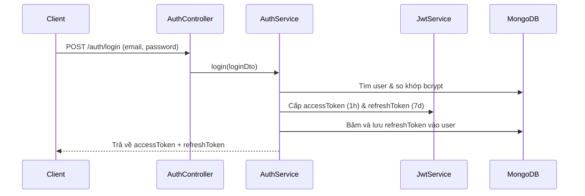
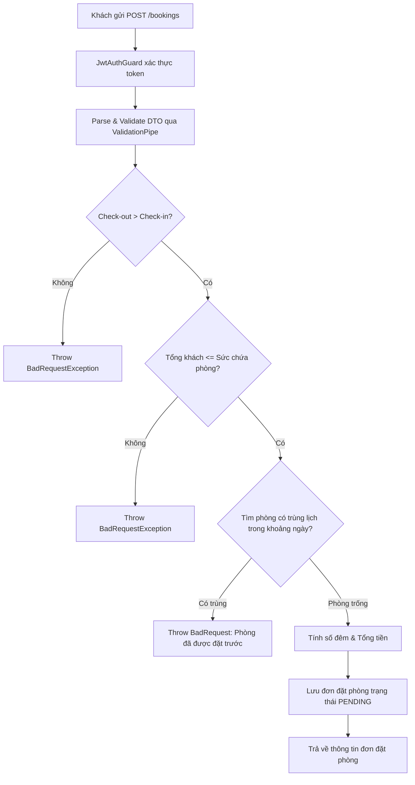

# Kiến Trúc Dự Án (Project Architecture)

Tài liệu này tóm tắt bản đồ kiến trúc thư mục `src/` của dự án **Website Quản lý và Đặt phòng Homestay / Khách sạn** xây dựng bằng **NestJS** và **MongoDB**, tuân theo mô hình **Modular & MVC** theo đúng giáo trình Bài 02.

---

## 🗺 Sơ Đồ Tổng Quan Bản Đồ Thư Mục `src/`

```
src/
├── main.ts                          # File khởi chạy chính (Bootstrap, Swagger, Global Pipes, Filters)
├── app.module.ts                    # Root module kết nối Config, MongoDB, Middleware và các Module con
├── app.controller.ts                # Endpoint thông tin hệ thống (GET /)
├── app.service.ts                   # Logic phản hồi thông tin hệ thống
│
├── entities/                        # Định nghĩa cấu trúc Schema MongoDB (Mongoose)
│   ├── user.entity.ts               # Schema người dùng, mật khẩu băm, vai trò (Admin, Host, Customer)
│   ├── room.entity.ts               # Schema phòng / homestay, giá, sức chứa, địa chỉ, tiện ích
│   ├── booking.entity.ts            # Schema đơn đặt phòng, ngày check-in/out, số đêm, tổng tiền
│   └── review.entity.ts             # Schema đánh giá sao (1-5 sao) và nhận xét
│
├── modules/                         # Các module tính năng chia theo từng nghiệp vụ độc lập
│   ├── auth/                        # Xác thực JWT & Refresh Token (Bài 09, Bài 10)
│   │   ├── dto/                     # DTO đăng ký, đăng nhập, refresh token
│   │   ├── strategies/              # JwtStrategy (Passport)
│   │   ├── auth.controller.ts       # POST /auth/register, /auth/login, /auth/refresh, /auth/logout
│   │   ├── auth.service.ts          # Tạo token, verify refresh token, thu hồi token
│   │   └── auth.module.ts
│   │
│   ├── users/                       # Quản lý tài khoản người dùng
│   │   ├── dto/                     # CreateUserDto, UpdateUserDto
│   │   ├── users.controller.ts      # GET /users, GET /users/me, PATCH, DELETE
│   │   ├── users.service.ts         # Nghiệp vụ tìm kiếm, cập nhật thông tin user
│   │   └── users.module.ts
│   │
│   ├── rooms/                       # Quản lý Homestay / Khách sạn (Bài 06, Bài 14)
│   │   ├── dto/                     # CreateRoomDto, UpdateRoomDto, FilterRoomDto
│   │   ├── rooms.controller.ts      # CRUD phòng, tìm kiếm lọc theo giá/địa điểm/tiện ích
│   │   ├── rooms.service.ts         # Xử lý truy vấn phòng, lọc theo khoảng giá, số khách
│   │   └── rooms.module.ts
│   │
│   ├── bookings/                    # Đặt phòng & Quản lý đơn (Bài 06, Bài 14)
│   │   ├── dto/                     # CreateBookingDto, UpdateBookingStatusDto
│   │   ├── bookings.controller.ts   # POST /bookings, GET /my-bookings, GET /host-bookings
│   │   ├── bookings.service.ts      # Kiểm tra trùng lịch đặt, tính tổng tiền theo số đêm
│   │   └── bookings.module.ts
│   │
│   ├── reviews/                     # Đánh giá & Phản hồi (Bài 14)
│   │   ├── dto/                     # CreateReviewDto
│   │   ├── reviews.controller.ts    # POST /reviews, GET /reviews/room/:roomId
│   │   ├── reviews.service.ts       # Lưu đánh giá, tự động cập nhật rating trung bình phòng
│   │   └── reviews.module.ts
│   │
│   └── graphql/                     # Cổng giao tiếp GraphQL (Bài 13)
│       ├── types/                   # RoomGqlType, AddressGqlType
│       ├── resolvers/               # RoomResolver (Queries: getRooms, getRoomById)
│       └── app-graphql.module.ts    # Cấu hình ApolloDriver
│
├── common/                          # Các thành phần dùng chung toàn hệ thống
│   ├── decorators/
│   │   ├── roles.decorator.ts       # Decorator @Roles('admin', 'host', 'customer')
│   │   └── current-user.decorator.ts# Decorator @CurrentUser() lấy thông tin từ JWT
│   ├── filters/
│   │   └── http-exception.filter.ts # Bộ lọc bắt lỗi toàn cục, chuẩn hóa JSON lỗi (Bài 12)
│   ├── guards/
│   │   ├── jwt-auth.guard.ts        # Guard bảo vệ route bằng Passport JWT (Bài 09)
│   │   └── roles.guard.ts           # Guard kiểm tra quyền truy cập theo vai trò (RBAC)
│   ├── interceptors/
│   │   └── transform.interceptor.ts # Interceptor bọc response dạng { success, statusCode, data }
│   ├── middlewares/
│   │   └── logger.middleware.ts     # Middleware ghi log HTTP method, URL, IP, execution time (Bài 08)
│   └── pipes/
│       └── parse-object-id.pipe.ts  # Pipe kiểm tra định dạng MongoDB ObjectId hợp lệ (Bài 07)
│
├── config/                          # Cấu hình môi trường (Bài 11)
│   └── configuration.ts             # Quản lý PORT, MONGODB_URI, JWT_SECRET, REFRESH_TOKEN
│
├── scripts/                         # Script bảo trì & khởi tạo dữ liệu
│   └── seed.ts                      # Nạp dữ liệu mẫu ban đầu vào MongoDB
│
└── utils/                           # Các hàm tiện ích hỗ trợ (Bài 02)
    └── helpers.ts                   # calculateNights(), formatCurrencyVND()
```

---

## 🏛 Luồng Xử Lý Nghiệp Vụ Cốt Lõi

### 1. Luồng Xác Thực (Authentication & Refresh Token)


### 2. Luồng Đặt Phòng & Kiểm Tra Trùng Lịch (Booking Conflict Overlap)

