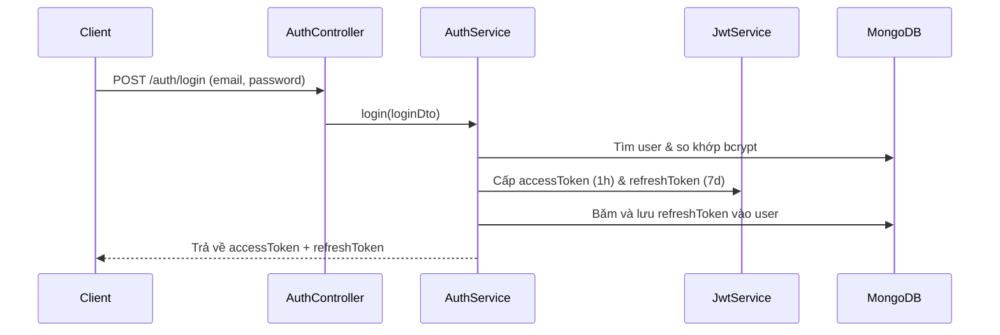
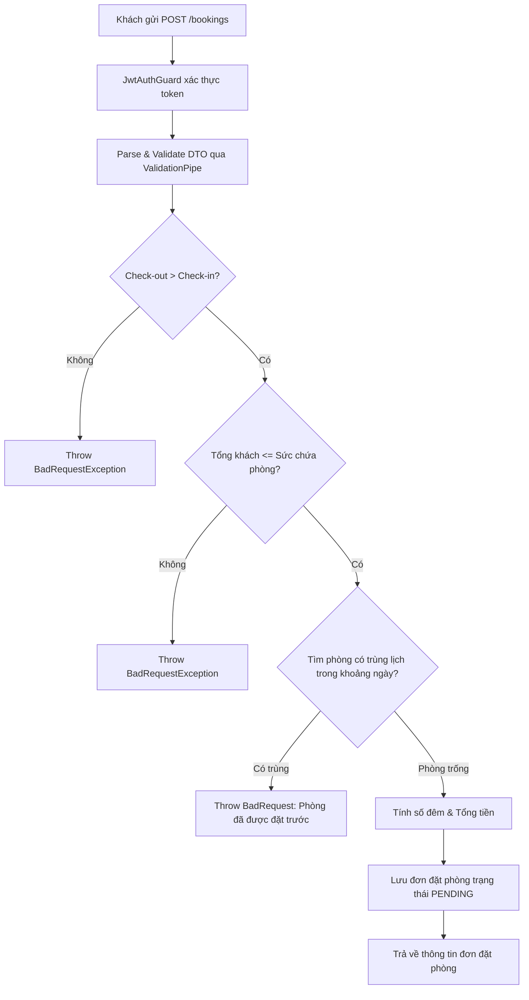

# Kiến Trúc Dự Án (Project Architecture)

Tài liệu này tóm tắt bản đồ kiến trúc thư mục `src/` của dự án **Website Quản lý và Đặt phòng Homestay / Khách sạn** xây dựng bằng **NestJS** và **MongoDB**, tuân theo mô hình **Modular & MVC** theo đúng giáo trình Bài 02.

---

## 🗺 Sơ Đồ Tổng Quan Bản Đồ Thư Mục `src/`

```
src/
├── main.ts                          # File khởi chạy chính (Bootstrap, Swagger, Global Pipes, Filters)
├── app.module.ts                    # Root module kết nối Config, MongoDB, Middleware và các Module con
├── app.controller.ts                # Endpoint thông tin hệ thống (GET /)
├── app.service.ts                   # Logic phản hồi thông tin hệ thống
│
├── entities/                        # Định nghĩa cấu trúc Schema MongoDB (Mongoose)
│   ├── user.entity.ts               # Schema người dùng, mật khẩu băm, vai trò (Admin, Host, Customer)
│   ├── room.entity.ts               # Schema phòng / homestay, giá, sức chứa, địa chỉ, tiện ích
│   ├── booking.entity.ts            # Schema đơn đặt phòng, ngày check-in/out, số đêm, tổng tiền
│   └── review.entity.ts             # Schema đánh giá sao (1-5 sao) và nhận xét
│
├── modules/                         # Các module tính năng chia theo từng nghiệp vụ độc lập
│   ├── auth/                        # Xác thực JWT & Refresh Token (09, 10)
│   │   ├── dto/                     # DTO đăng ký, đăng nhập, refresh token
│   │   ├── strategies/              # JwtStrategy (Passport)
│   │   ├── auth.controller.ts       # POST /auth/register, /auth/login, /auth/refresh, /auth/logout
│   │   ├── auth.service.ts          # Tạo token, verify refresh token, thu hồi token
│   │   └── auth.module.ts
│   │
│   ├── users/                       # Quản lý tài khoản người dùng
│   │   ├── dto/                     # CreateUserDto, UpdateUserDto
│   │   ├── users.controller.ts      # GET /users, GET /users/me, PATCH, DELETE
│   │   ├── users.service.ts         # Nghiệp vụ tìm kiếm, cập nhật thông tin user
│   │   └── users.module.ts
│   │
│   ├── rooms/                       # Quản lý Homestay / Khách sạn (06, 14)
│   │   ├── dto/                     # CreateRoomDto, UpdateRoomDto, FilterRoomDto
│   │   ├── rooms.controller.ts      # CRUD phòng, tìm kiếm lọc theo giá/địa điểm/tiện ích
│   │   ├── rooms.service.ts         # Xử lý truy vấn phòng, lọc theo khoảng giá, số khách
│   │   └── rooms.module.ts
│   │
│   ├── bookings/                    # Đặt phòng & Quản lý đơn (06, 14)
│   │   ├── dto/                     # CreateBookingDto, UpdateBookingStatusDto
│   │   ├── bookings.controller.ts   # POST /bookings, GET /my-bookings, GET /host-bookings
│   │   ├── bookings.service.ts      # Kiểm tra trùng lịch đặt, tính tổng tiền theo số đêm
│   │   └── bookings.module.ts
│   │
│   ├── reviews/                     # Đánh giá & Phản hồi (14)
│   │   ├── dto/                     # CreateReviewDto
│   │   ├── reviews.controller.ts    # POST /reviews, GET /reviews/room/:roomId
│   │   ├── reviews.service.ts       # Lưu đánh giá, tự động cập nhật rating trung bình phòng
│   │   └── reviews.module.ts
│   │
│   └── graphql/                     # Cổng giao tiếp GraphQL (13)
│       ├── types/                   # RoomGqlType, AddressGqlType
│       ├── resolvers/               # RoomResolver (Queries: getRooms, getRoomById)
│       └── app-graphql.module.ts    # Cấu hình ApolloDriver
│
├── common/                          # Các thành phần dùng chung toàn hệ thống
│   ├── decorators/
│   │   ├── roles.decorator.ts       # Decorator @Roles('admin', 'host', 'customer')
│   │   └── current-user.decorator.ts# Decorator @CurrentUser() lấy thông tin từ JWT
│   ├── filters/
│   │   └── http-exception.filter.ts # Bộ lọc bắt lỗi toàn cục, chuẩn hóa JSON lỗi (12)
│   ├── guards/
│   │   ├── jwt-auth.guard.ts        # Guard bảo vệ route bằng Passport JWT (09)
│   │   └── roles.guard.ts           # Guard kiểm tra quyền truy cập theo vai trò (RBAC)
│   ├── interceptors/
│   │   └── transform.interceptor.ts # Interceptor bọc response dạng { success, statusCode, data }
│   ├── middlewares/
│   │   └── logger.middleware.ts     # Middleware ghi log HTTP method, URL, IP, execution time (08)
│   └── pipes/
│       └── parse-object-id.pipe.ts  # Pipe kiểm tra định dạng MongoDB ObjectId hợp lệ (07)
│
├── config/                          # Cấu hình môi trường (11)
│   └── configuration.ts             # Quản lý PORT, MONGODB_URI, JWT_SECRET, REFRESH_TOKEN
│
├── scripts/                         # Script bảo trì & khởi tạo dữ liệu
│   └── seed.ts                      # Nạp dữ liệu mẫu ban đầu vào MongoDB
│
└── utils/                           # Các hàm tiện ích hỗ trợ (02)
    └── helpers.ts                   # calculateNights(), formatCurrencyVND()
```

---

## 🏛 Luồng Xử Lý Nghiệp Vụ Cốt Lõi

### 1. Luồng Xác Thực (Authentication & Refresh Token)


### 2. Luồng Đặt Phòng & Kiểm Tra Trùng Lịch (Booking Conflict Overlap)


---

## 🖥️ Frontend — StayNest (thư mục `public/`)

Frontend là bộ trang HTML tĩnh đa trang (multi-page) được chính server NestJS phục vụ tại `/`
qua `app.useStaticAssets(join(process.cwd(), 'public'), { index: 'index.html' })` trong `main.ts`
(với `NestExpressApplication`). Không cần build step — Tailwind CSS qua CDN, JS thuần (vanilla).

### 1. Cấu trúc trang & thành phần dùng chung

```
public/
├── assets/
│   ├── api.js        # Fetch wrapper: gắn Bearer token, tự refresh khi 401 rồi retry 1 lần,
│   │                 #   chuẩn hóa lỗi theo HttpExceptionFilter { statusCode, message }
│   ├── auth.js       # Trạng thái đăng nhập (localStorage) + RBAC:
│   │                 #   requireAuth(), requireRole(roles), Auth.isHost()/isAdmin(),
│   │                 #   login/register/logout/refreshTokens
│   └── ui.js         # Header động theo vai trò (menu avatar + đăng xuất), toast,
│                     #   badge trạng thái, renderer thẻ phòng dùng chung,
│                     #   engine favorites: UI.favorites.load()/toggle(), UI.favBtnHTML(),
│                     #   UI.bindFavButtons() — đồng bộ nút ♥ với server
├── index.html        # Trang chủ: hero, thanh tìm kiếm nổi (địa điểm/ngày/số khách),
│                     #   bộ lọc nâng cao (giá, từ khóa), lọc loại phòng, modal đặt nhanh,
│                     #   đăng nhập nhanh trong modal, nút ♥ lưu phòng (server-backed)
├── auth.html         # Đăng nhập / Đăng ký (tab, chọn vai trò khách hàng/chủ nhà)
├── room.html         # Chi tiết phòng: gallery, tiện ích, thẻ chủ nhà, đặt phòng,
│                     #   đánh giá (xem/gửi/xóa), nút ♥ yêu thích, khối "Ngày đã có khách đặt"
│                     #   (GET /rooms/:id/availability) + chặn chọn ngày trùng trước khi gửi
├── favorites.html    # Phòng yêu thích: grid thẻ phòng đã lưu, bỏ khỏi danh sách
├── my-bookings.html  # Đơn của khách: lọc theo trạng thái, hủy đơn
├── profile.html      # Xem/sửa hồ sơ (tên, SĐT, avatar) qua PATCH /users/:id
├── host.html         # Dashboard chủ nhà (role host/admin): thống kê, CRUD phòng,
│                     #   quản lý đơn (xác nhận/hoàn thành/hủy)
└── admin.html        # Trang quản trị (role admin): thống kê, quản lý người dùng
                      #   (tìm kiếm, xóa), toàn bộ đơn + đổi trạng thái
```

### 2. Phân quyền hiển thị (RBAC phía client)

| Vai trò | Header/Nav | Trang được truy cập |
|---------|-----------|---------------------|
| Khách (chưa đăng nhập) | Đăng nhập / Đăng ký | index, room, auth |
| `customer` | Yêu thích, Đơn của tôi | + favorites, my-bookings, profile |
| `host` | Yêu thích, Đơn của tôi, Dashboard chủ nhà | + host.html (CRUD phòng của mình, đơn vào phòng mình) |
| `admin` | Yêu thích, Đơn của tôi, Dashboard chủ nhà, Quản trị | + admin.html (users, tất cả đơn), host.html |

- Chưa đăng nhập vào trang bảo vệ → redirect `auth.html?mode=login&next=...`.
- Sai vai trò → redirect `index.html?denied=1` kèm toast.
- Server vẫn là nguồn chân lý: mọi API đều có `JwtAuthGuard`/`RolesGuard`; client chỉ ẩn/hiện nút.

### 3. Luồng xác thực phía frontend

```mermaid
sequenceDiagram
    participant P as Trang HTML
    participant A as auth.js
    participant API as api.js
    participant S as NestJS API
    P->>A: Auth.loadUser()
    A->>API: GET /users/me (Bearer access_token)
    API->>S: fetch + Authorization
    S-->>API: 401 (hết hạn)?
    API->>A: Auth.refreshTokens() → POST /auth/refresh
    A->>S: { refreshToken }
    S-->>A: access_token mới → retry request 1 lần
    API-->>P: dữ liệu; nếu vẫn 401 → clearSession + redirect trang auth
```

Token lưu trong `localStorage` (`access_token`, `refresh_token`, `current_user`).

### 4. Phòng yêu thích & lịch trống của phòng

- **Favorites (lưu trên server):** entity `Favorite` (`userId` + `roomId`, index kép unique).
  API: `GET /favorites` (populate phòng), `GET /favorites/ids` (nhẹ, tô màu nút ♥),
  `POST /favorites/:roomId/toggle`, `POST /favorites/:roomId`, `DELETE /favorites/:roomId` —
  tất cả yêu cầu đăng nhập. Trước đây nút ♥ chỉ lưu `localStorage` (mất khi đổi máy), đã nâng cấp.
- **Availability:** `GET /rooms/:id/availability` (công khai) trả các khoảng
  `checkInDate → checkOutDate` của booking `pending/confirmed` chưa qua. Backend chặn
  trùng lịch ngay khi `POST /bookings`; frontend room.html hiển thị "Ngày đã có khách đặt"
  và chặn trước khi gửi để tránh round-trip thừa.

### 5. Rate limiting (`@nestjs/throttler`)

- Guard toàn cục `VNThrottlerGuard` (kế thừa `ThrottlerGuard`, thông báo 429 tiếng Việt) qua `APP_GUARD`.
- Mặc định **120 req/phút/IP**; riêng: đăng nhập **10/phút**, đăng ký **5/phút**,
  refresh **20/phút**, tạo booking **20/phút** (`@Throttle` trên từng route).

### 6. Lưu ý vận hành

- `useStaticAssets` đọc `public/` theo `process.cwd()` → luôn chạy npm script từ **thư mục gốc dự án**.
- Endpoint thông tin hệ thống là `GET /api` (trang chủ tĩnh chiếm `/`).
- Tài khoản demo (sau `npm run seed`): `customer@homestay.com`, `host@homestay.com`,
  `admin@homestay.com` — mật khẩu `123456`.
